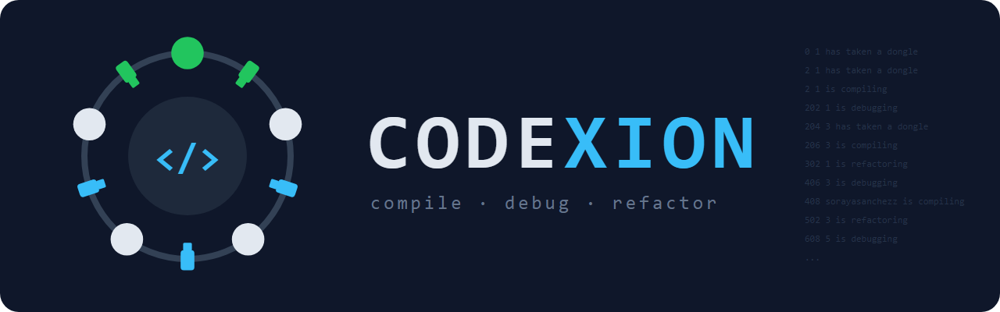

*This project has been created as part of the 42 curriculum by sosanche.*

# Codexion



## Description

La idea es que hay una mesa redonda con varios programadores (los **coders**). Entre
cada dos coders hay un **dongle USB**, así que hay tantos dongles como coders.

Para **compilar**, un coder necesita **dos dongles a la vez**: el que tiene a
su izquierda y el que tiene a su derecha. El problema es que esos dongles
también los quieren sus vecinos, así que tienen que turnarse.

Cada coder hace siempre lo mismo, en bucle:

```
coge sus 2 dongles → compila → suelta los dongles y depura → refactoriza → otra vez
```

Si un coder se pasa demasiado tiempo sin **empezar** a compilar, **se quema**
("burned out") y se acaba todo. La gracia del proyecto es repartir los dongles
bien para que nadie se queme.

### Datos

- Cada coder es un **hilo** (un pthread).
- Cuando dos coders quieren el mismo dongle, el dongle decide a quién se lo da.
  Hay dos formas de decidir, y la eliges tú al ejecutar:
  - fifo: se lo da al que lo **pidió primero**. Como la cola del súper.
  - edf: se lo da al que está **más cerca de quemarse**. Como urgencias en un
    hospital: entra primero el que está peor.
- Cuando sueltas un dongle, se queda **"enfriándose"** un rato (el *cooldown*)
  y nadie lo puede usar hasta que pasa ese tiempo.
- Hay un hilo extra, el **monitor**, que no compila: solo vigila. En cuanto
  alguien se quema, lo dice (en menos de 10 ms) y para todo.

### ¿Cuándo se acaba?

- **Si sale bien:** cuando **todos** han compilado las veces que pediste. El
  programa simplemente termina, sin ningún mensaje especial.
- **Si sale mal:** cuando alguien se quema, la última línea es "X burned out".

## Instructions

### Compilar

```bash
cd coders
make
```

Te crea el programa `codexion`. Además tienes `make clean` (borra los .o),
`make fclean` (borra los .o y el programa), `make re` (borra todo y compila
de cero) y `make help` (te enseña esta lista).

### Ejecutar

```bash
./codexion 5 800 200 100 100 3 10 edf
```

Son 8 argumentos y todos son obligatorios. Los tiempos van en milisegundos.

| Ejemplo | Argumento                     | Qué es                                                 |
|---------|-------------------------------|--------------------------------------------------------|
| 5       | `number_of_coders`            | Cuántos coders (y dongles) hay                         |
| 800     | `time_to_burnout`             | Lo que aguanta sin **empezar** a compilar antes de quemarse |
| 200     | `time_to_compile`             | Lo que tarda en compilar (con los 2 dongles)           |
| 100     | `time_to_debug`               | Lo que tarda en depurar                                |
| 100     | `time_to_refactor`            | Lo que tarda en refactorizar                           |
| 3       | `number_of_compiles_required` | Cuántas veces tiene que compilar cada uno              |
| 10      | `dongle_cooldown`             | Lo que se enfría un dongle después de soltarlo         |
| edf     | `scheduler`                   | fifo o edf                                             |

Si algo está mal (faltan o sobran argumentos, hay negativos, letras, decimales,
números gigantes, FIFO en mayúsculas, 0 coders o 0 compilaciones), sale
"Error: invalid arguments" con el uso correcto y el programa no arranca.

### Qué sale por pantalla

Cada línea es: **cuándo** (ms desde el principio), **quién** (el número del
coder) y **qué hace**.

| Mensaje              | Qué quiere decir                                           |
|----------------------|------------------------------------------------------------|
| `has taken a dongle` | Ha cogido un dongle. Antes de compilar siempre salen dos   |
| `is compiling`       | Empieza a compilar                                         |
| `is debugging`       | Ha terminado de compilar, suelta los dongles y depura      |
| `is refactoring`     | Empieza a refactorizar                                     |
| `burned out`         | Se ha quemado. Se acaba todo                               |

Así queda una ejecución de verdad que **sale bien** (3 coders, 2 compilaciones
cada uno):

```
$ ./codexion 3 800 200 100 100 2 0 edf
0 1 has taken a dongle
0 1 has taken a dongle
0 1 is compiling
200 1 is debugging
200 2 has taken a dongle
200 2 has taken a dongle
200 2 is compiling
300 1 is refactoring
...
1000 3 is compiling
1100 2 is refactoring
1200 3 is debugging
```

Fíjate en que el coder 2 coge los dongles justo cuando el 1 los suelta. Al
final todos han compilado 2 veces, así que se acaba sin decir nada más.

Y así queda una en la que **alguien se quema**:

```
$ ./codexion 4 310 200 100 100 5 10 edf
...
300 1 is refactoring
300 3 is refactoring
310 1 burned out
```

### Pruebas

| Prueba                                      | Qué tiene que pasar                                         |
|---------------------------------------------|-------------------------------------------------------------|
| `./codexion 5 800 200 100 100 5 0`     | Error y no arranca                                          |
| `./codexion 1 800 200 100 100 5 0 fifo`     | Coge su único dongle y se quema en el ms 800                |
| `./codexion 5 800 200 100 100 5 10 edf`     | Nadie se quema                                              |
| `./codexion 4 800 200 100 100 5 0 fifo`     | Nadie se quema                                              |
| `./codexion 200 800 200 100 100 3 10 edf`   | Nadie se quema, incluso con 200 coders                      |
| `./codexion 4 310 200 100 100 5 10 edf`     | El coder 1 se quema en el ms 310 o 311 (es imposible llegar) |

Y para ver que no hay fugas de memoria ni líos entre hilos:

```bash
valgrind --leak-check=full ./codexion 4 800 200 100 100 3 10 edf
valgrind --tool=helgrind   ./codexion 5 800 200 100 100 3 10 edf
```

### ¿Alguien se ha quemado? ¿Está mal el programa?

No siempre: con algunos números es **imposible** que nadie se queme. Dos
vecinos no pueden compilar a la vez, así que los coders van por turnos: **2
turnos** si son pares y **3** si son impares.

Para que nadie se queme, `time_to_burnout` tiene que ser **mayor** que:

1. turnos × (compilar + cooldown)
2. compilar + depurar + refactorizar

Deja unos 50-100 ms de margen, porque el ordenador nunca es exacto. Con edf
y números posibles nadie debería quemarse. Con fifo no está garantizado.

## Blocking cases handled

Estos son los problemas típicos cuando varios hilos comparten cosas, y cómo los
evito.

### Que se queden todos bloqueados (deadlock)

**El problema:** si cada coder coge primero su dongle de la izquierda y luego
espera el de la derecha, puede pasar que todos cojan el izquierdo a la vez.
Entonces cada uno espera un dongle (que no está disponible), nadie suelta el suyo y se quedan así para siempre.

Para que haya deadlock se tienen que cumplir **las 4 condiciones de Coffman a
la vez**:

1. **Exclusión mutua:** un dongle solo lo puede tener un coder.
2. **Retener y esperar:** un coder se queda con un dongle mientras espera el
   otro.
3. **No expropiación:** nadie le puede quitar un dongle a otro.
4. **Espera circular:** cada coder espera al siguiente y se forma un círculo.

Si falla una sola, no puede haber deadlock. Yo rompo la **2**: un coder solo
coge sus dongles cuando **los dos** están libres, y los coge en el mismo paso.
Mientras espera no tiene ningún dongle, así que nunca bloquea a nadie.

### Que a alguien nunca le toque (starvation)

**El problema:** que un coder se quede esperando siempre porque sus vecinos le
adelantan una y otra vez.

**La solución:** cada dongle tiene una **cola con prioridad** (un *heap*)
donde se apuntan los coders que lo quieren:

- Con fifo, va antes el que lo pidió antes.
- Con edf, va antes el que se quema antes
  (inicio de su última compilación + time_to_burnout).

Un coder **no puede coger un dongle si en la cola hay alguien que va antes que
él**. Así nadie se cuela. Si dos empatan, no se bloquean entre ellos y se lo
lleva el que llegue primero.

Además, al principio los coders pares (y el último, si son impares) esperan
la mitad de lo que se tarda en compilar. Así no se pegan todos por los dongles
en el milisegundo 0.

### El cooldown

Cuando un coder suelta un dongle, se apunta a qué hora vuelve a estar libre:
`available_at = ahora + dongle_cooldown`. Antes de esa hora, nadie lo puede
coger.

### Detectar a tiempo que alguien se quema

El monitor mira a todos los coders **cada 1 ms**. Si alguno lleva
`time_to_burnout` ms o más sin empezar a compilar, escribe "burned out" y lo
para todo. En las pruebas, el mensaje sale entre 0 y 1 ms tarde (el límite
son 10 ms).

Los coders no se duermen de golpe: duermen a trocitos de 0,1 ms y miran cada
vez si ya se ha acabado. Así todos paran casi al momento.

### Que los mensajes no se mezclen

Para escribir un mensaje hay que coger `log_mutex`, así que solo escribe uno a
la vez y las líneas nunca se mezclan. Además, con ese mutex cogido se mira si
ya se ha acabado, por eso **nunca sale nada después de "burned out"**.

Además, "is debugging" se escribe **antes** de soltar los dongles. Si fuera
al revés, el vecino podría escribir "has taken a dongle" antes, y leyendo el
log parecería que un dongle lo tienen dos personas a la vez.

## Thread synchronization mechanisms

### Las herramientas que uso

Un **mutex** es como el cerrojo de un baño: solo puede entrar uno, y los demás
esperan a que salga. Una **variable de condición** deja a los hilos dormidos
hasta que reciben un aviso.

| Herramienta              | Para qué                                                      |
|--------------------------|---------------------------------------------------------------|
| `scheduler_mutex`        | El estado de los dongles: si están ocupados, el cooldown y sus colas |
| `mutex` de cada dongle   | Lo tiene cogido el coder mientras compila                     |
| `log_mutex`              | Escribir en pantalla y la hora en que cada coder empezó a compilar |
| `finished_mutex`         | Saber si la simulación se ha acabado                          |
| `start_cond`             | Que todos los hilos empiecen a la vez                         |

Mientras espera su turno, un coder suelta `scheduler_mutex`, duerme 0,2 ms y
vuelve a mirar. Así no bloquea a nadie mientras espera.

### Ejemplos de problemas que evito

- **Dos coders cogiendo el mismo dongle:** para marcar un dongle como ocupado
  hay que tener `scheduler_mutex`. Si dos lo intentan a la vez, uno entra
  primero y lo marca, y el segundo ya lo ve ocupado.
- **El monitor leyendo una hora a medias:** el coder cambia su hora de
  "empecé a compilar" y escribe "is compiling" con `log_mutex` cogido. El
  monitor solo mira esa hora con el mismo mutex, así que nunca la pilla a
  medio cambiar. Y la hora guardada es la misma que sale en pantalla.
- **Mensajes después de quemarse:** el monitor escribe "burned out" y marca el
  final sin soltar `log_mutex`. Ningún coder puede colarse en medio a escribir
  algo.

### Cómo se entienden los coders y el monitor

No se hablan directamente: comparten dos cosas, cada una con su mutex.

- **La hora a la que cada coder empezó a compilar** (`log_mutex`): el coder la
  apunta y el monitor la lee para ver si alguien se ha quemado.
- **"¿Se ha acabado?"** (`finished_mutex`): lo marca el monitor cuando alguien
  se quema, o el último coder en terminar sus compilaciones. Todos los hilos lo
  miran con `simulation_finished()` y, si se ha acabado, paran.

Para que los propios mutex no se bloqueen entre ellos, siempre se cogen en el
mismo orden: `dongle → log_mutex → finished_mutex` y
`scheduler_mutex → finished_mutex`. Nunca al revés.

## Resources

### Para aprender más

- E. W. Dijkstra, *Cooperating Sequential Processes* (1965). Es el problema de
  los filósofos comensales, y este proyecto es una versión de ese problema.
- E. G. Coffman y otros, *System Deadlocks* (1971). Las 4 condiciones del
  deadlock.
- Manual de los hilos POSIX:
  <https://man7.org/linux/man-pages/man7/pthreads.7.html>
- Manual de Helgrind, para pillar errores entre hilos:
  <https://valgrind.org/docs/manual/hg-manual.html>

### AI usage

He usado ChatGTP para:

- **Teoría**: ayudarme a entender la lógica, sobretodo me ha ayudado con los threads, mutex y cond.

He usado Claude para:

- **Hacer test:** le he pedido que haga test normales y en casos límites, gracias a ello he encontrado errores como por ejemplo, el orden de "is debugging" al soltar los dongles, o que todos los hilos salgan a la vez.
- **Errores:** pasar valgrind, helgrind y drd mucho más rápido.
- **Readme:** ayudarme a ordenar el readme y a estrucucturarmelo, también hacerlo más visual como ponerme las tablas, las negritas y los subrrayados.
